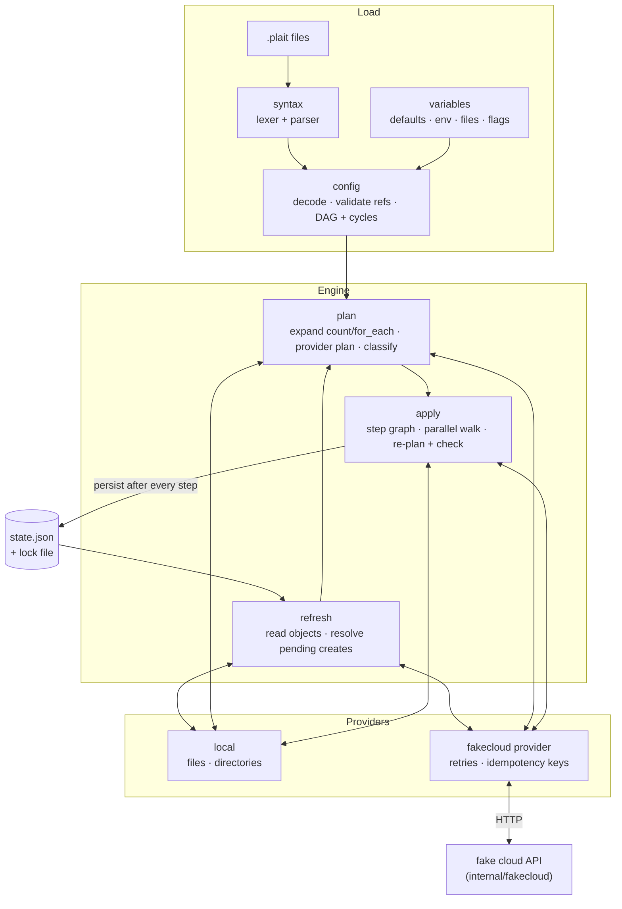

# plait

A small declarative infrastructure-as-code engine in Go, built to show how
tools like Terraform work inside: an HCL-subset language, a dependency graph
with cycle detection, plans with "known after apply" values, a parallel
apply that persists state after every step, a JSON state file with a lock,
and a provider plugin interface with two providers — the local filesystem and
a fake cloud whose HTTP API ships in this repository.

```console
$ plait plan
  # fakecloud_instance.web[0] must be replaced
-/+ resource "fakecloud_instance" "web" {
      ~ id         = "i-0002" -> (known after apply)
      ~ network_id = "net-0001" -> (known after apply) # forces replacement
      ~ private_ip = "10.20.0.5" -> (known after apply)
        # (4 unchanged attributes hidden)
    }
```

**Who it is for:** engineers who use Terraform/OpenTofu and want to see the
plan/apply/state model in about 9,400 lines of readable Go (plus about 3,700
lines of tests; counted by `make loc`), and anyone who needs
a compact reference for dependency-ordered, crash-safe reconciliation. It is
a learning and portfolio project, not a Terraform replacement: it manages
local files and the in-repo fake cloud only.

What sets it apart from a toy: interrupted applies are recoverable by
design. Every create is written to state as *pending* with an idempotency
token before the request is sent, so a `kill -9` at the worst possible moment
(after the cloud committed, before plait saw the response) is repaired by the
next run without losing or duplicating anything. The tests prove this by
SIGKILLing the real CLI from inside the fake cloud's commit hook.

## Features

- **Language** — blocks, attributes, all arithmetic/comparison/logical
  operators, conditionals, `${}` string templates, heredocs, splats
  (`web[*].ip`), `for` expressions for lists and maps, `...` argument
  expansion, 39 built-in functions (`format`, `merge`, `cidrsubnet`,
  `jsonencode`, `file`, …), `#`, `//` and `/* */` comments.
- **Configuration** — `variable` (typed: `string`, `number`, `bool`,
  `list(T)`, `map(T)`), `locals`, `resource` with `count`, `for_each`,
  `depends_on` and `lifecycle { create_before_destroy, prevent_destroy,
  ignore_changes }`, `output`, `provider`. Variables from defaults,
  `PLAIT_VAR_*`, `plait.plaitvars`, `-var-file` and `-var`.
- **Graph** — reference analysis builds a dependency DAG; cycles are found
  with Tarjan's algorithm and reported as paths
  (`local.a -> local.b -> local.a`).
- **Plan** — create / update in place / replace (`-/+` or `+/-` with
  create_before_destroy) / delete, with the attribute that forces each
  replacement, unknown values shown as `(known after apply)`, drift detection,
  orphan and tainted/deposed handling, saved plans (`plan -out`, `apply FILE`)
  with stale-plan and changed-config detection, JSON output.
- **Apply** — instance-level step graph, bounded parallel walk, re-planning
  each instance with real dependency values and checking it against the
  reviewed plan, failure isolation (only dependents of a failed step are
  skipped), state persisted after every step.
- **State** — JSON with lineage and serial, atomic write-rename with backup,
  advisory lock file with automatic removal of locks left by dead processes.
- **Providers** — in-process plugin interface with schema-driven validation
  and planning; `local_file` / `local_directory`; `fakecloud_network` /
  `fakecloud_instance` / `fakecloud_bucket` over HTTP with retries and
  idempotency keys.
- **Fake cloud** — `plait fakecloud` serves an in-memory API with
  referential integrity (409 when deleting a network that still has
  instances), immutable fields, unique bucket names, IP allocation, and fault
  injection (fail before commit, fail after commit, latency).

## Architecture



`docs/ARCHITECTURE.md` covers the value model, both graphs and their
ordering rules, the write-ahead apply protocol and a crash-point table, the
provider contract, and the complexity of each stage.
`docs/TERRAFORM_COMPARISON.md` maps every concept to Terraform's and lists
what is simplified and what is deliberately different.

## Quickstart

Requires Go 1.24+ (developed with 1.27) and, for `make check`,
golangci-lint v2.

```sh
make build                       # -> bin/plait
bin/plait fakecloud &            # fake cloud API on http://127.0.0.1:8787
cd examples/webstack
../../bin/plait plan
../../bin/plait apply            # asks for "yes"; -auto-approve skips it
../../bin/plait output
../../bin/plait destroy -auto-approve
```

Or run the whole scripted tour, which starts its own fake cloud on a free
port and cleans up afterwards:

```sh
make demo
```

### Example configuration

From `examples/webstack/main.plait`:

```hcl
resource "fakecloud_instance" "web" {
  count      = var.web_count
  name       = format("%s-web-%02d", local.prefix, count.index)
  size       = var.web_size
  network_id = fakecloud_network.main.id
  tags       = merge(local.common_tags, { role = "web" })
}

resource "fakecloud_bucket" "data" {
  for_each   = toset(var.buckets)
  name       = "${local.prefix}-${each.key}"
  versioning = each.key == "media"
}

resource "local_file" "inventory" {
  path = "out/inventory.ini"
  content = join("\n", concat(
    ["[web]"],
    [for i in fakecloud_instance.web : "${i.name} ansible_host=${i.private_ip}"],
    ["", "[buckets]"],
    [for k, b in fakecloud_bucket.data : "${k} = ${b.arn}"],
  ))
  depends_on = [local_directory.out]
}
```

### Commands

| Command | Purpose |
|---|---|
| `plait validate` | syntax, references, types of defaults, dependency cycles |
| `plait plan [-out FILE] [-destroy] [-refresh=false] [-json] [-detailed-exitcode]` | show (and optionally save) the changes |
| `plait apply [-auto-approve] [FILE]` | apply a fresh plan, or exactly a saved one |
| `plait destroy [-auto-approve]` | delete everything in state, dependents first |
| `plait refresh` | record drift in state without changing infrastructure |
| `plait show [-json] [FILE]` | show state, or a saved plan |
| `plait state list` / `state show ADDR` | inspect tracked instances |
| `plait output [-json] [-raw] [NAME]` | print outputs |
| `plait graph [-apply]` | DOT graph of the configuration, or of the apply steps |
| `plait force-unlock ID` | remove a lock held by a process on another host |
| `plait fakecloud [-addr] [-token] [-latency-ms]` | run the fake cloud API |

Common flags: `-dir`, `-state`, `-var NAME=VALUE`, `-var-file FILE`,
`-parallelism N` (default 4), `-lock-timeout`. `PLAIT_LOG=debug|info` enables
structured logs on stderr.

## Demo output

Excerpts from a real `make demo` run (repetitive attribute lines trimmed,
marked `…`; the full run also scales out, resizes, and destroys).

```text
==> drift: delete a bucket behind plait's back; apply notices and recreates it
(deleted bucket bkt-0002 directly through the fake cloud API)
$ plait apply -auto-approve -var web_count=3 -var web_size=medium
Note: Objects have changed outside of plait

  # fakecloud_bucket.data["logs"] has been deleted

plait will perform the following actions:

  # fakecloud_bucket.data["logs"] will be created
  + resource "fakecloud_bucket" "data" {
      + arn        = (known after apply)
      + id         = (known after apply)
      + name       = "dev-shop-logs"
      + versioning = false
    }

  # local_file.inventory will be updated in-place
  ~ resource "local_file" "inventory" {
      ~ content        = "[web]\ndev-shop-web-00 ansible_host=10.20.0.4\n…" -> (known after apply)
      ~ content_sha256 = "e02f74018b1e3bad73ab7fd5bb07ab6a717380e6a85c1b80b529e326e540a67c" -> (known after apply)
      ~ size           = 197 -> (known after apply)
        # (3 unchanged attributes hidden)
    }

Plan: 1 to add, 1 to change, 0 to destroy.
…
fakecloud_bucket.data["logs"]: Creating...
fakecloud_bucket.data["logs"]: Creation complete after 0s [id=bkt-0003]
local_file.inventory: Modifying...
local_file.inventory: Modifications complete after 1ms [id=out/inventory.ini]

Apply complete! Resources: 1 added, 1 changed, 0 destroyed.
…
==> crash: kill -9 plait in the middle of an apply
killed plait (pid 24842) mid-apply; its last progress lines:
fakecloud_instance.web[3]: Creating...
fakecloud_instance.web[3]: Creation complete after 402ms [id=i-0004]
fakecloud_instance.web[4]: Creating...

state after the crash (a stale lock is left behind):
plait.state.json.lock
   1 "status": "pending"
   9 "status": "ready"
instances on the fake cloud: 5

==> recover: the stale lock is broken, refresh finds the in-flight object by its idempotency token
$ plait apply -auto-approve -var web_count=5 -var web_size=medium
time=2026-10-25T17:18:19.289+05:30 level=WARN msg="removed a stale state lock left by a process that no longer exists" lock_id=ab5eec34ae8f pid=24842 operation=apply
Note: Objects have changed outside of plait

  # fakecloud_instance.web[4] was being created when plait was interrupted; the object exists and is now tracked

plait will perform the following actions:

  # local_file.inventory will be updated in-place
  ~ resource "local_file" "inventory" {
      ~ content        = "[web]\ndev-shop-web-00 ansible_host=10.20.0.4\n…" -> "[web]\ndev-shop-web-00 ansible_host=10.20.0.4\n…"
      ~ content_sha256 = "e02f74018b1e3bad73ab7fd5bb07ab6a717380e6a85c1b80b529e326e540a67c" -> "5a93a8173be8e40493be0c3aff6d36dfa6e54860520e57a1aeb049be7a1a18f9"
      ~ size           = 197 -> 275
        # (3 unchanged attributes hidden)
    }

Plan: 0 to add, 1 to change, 0 to destroy.

Changes to Outputs:
  ~ inventory_sha256 = "e02f74018b1e3bad73ab7fd5bb07ab6a717380e6a85c1b80b529e326e540a67c" -> "5a93a8173be8e40493be0c3aff6d36dfa6e54860520e57a1aeb049be7a1a18f9"
  ~ web_ips          = ["10.20.0.4", "10.20.0.5", "10.20.0.6"] -> ["10.20.0.4", "10.20.0.5", "10.20.0.6", "10.20.0.7", "10.20.0.8"]

local_file.inventory: Modifying...
local_file.inventory: Modifications complete after 0s [id=out/inventory.ini]

Apply complete! Resources: 0 added, 1 changed, 0 destroyed.
…
==> destroy everything
…
fakecloud_network.main: Destroying...
fakecloud_network.main: Destruction complete after 0s

Apply complete! Resources: 0 added, 0 changed, 10 destroyed.

$ curl http://127.0.0.1:52472/v1/_stats
{"requests":53,"max_in_flight":3,"objects":{"buckets":0,"instances":0,"networks":0},"events":20}
```

The crash step: with 400 ms of injected API latency and `-parallelism 1`,
plait is SIGKILLed while `web[4]`'s create is in flight. The fake cloud
finishes that request; the next apply finds the object through the token
stored in the pending record, so the plan has nothing left to create — five
instances, no duplicate — and, because every instance is now known, even the
inventory file's new content and digest are known at plan time.

## Testing

`make check` runs `gofmt` check, `go vet`, `golangci-lint` (zero issues),
all tests with the race detector, and a coverage gate (≥ 80% of statements
in `internal/...`, measured across all test binaries).

| Suite | What it proves |
|---|---|
| **Golden plans** (`internal/engine/testdata/golden/*`, 9 cases) | Rendered plan text *and* the apply step graph for create, update, forced replacement, create_before_destroy, orphans, tainted + deposed, ignore_changes, no-op and destroy; each plan also round-trips through the saved-plan JSON. Regenerate with `go test ./internal/engine -run TestGoldenPlans -update`. |
| **Integration** (`test/integration`) | Apply, update, count shrink, out-of-band deletion and modification (drift), refresh, forced replacement with event-order assertions, create_before_destroy order, destroy — all against the fake cloud over HTTP; bounded parallelism; retried transient faults without duplicates; hard failures that skip only dependents and converge on the next run; saved/stale plans; lock exclusion. |
| **Crash recovery** (`test/integration/crash_test.go`) | The test binary re-executes itself as the plait CLI and is SIGKILLed from the fake cloud's commit hook: mid-create (pending → recovered, stale lock broken, no duplicate), mid-destroy (lost delete → drift → converge), mid-create_before_destroy (deposed objects cleaned up). |
| **Engine unit** | Failure isolation, tainting, lost and abandoned creates (token reuse against a late-arriving request), inconsistent final plans, plan error table, prevent_destroy, create_before_destroy cycles, persistence failures. |
| **Providers / fake cloud / CLI / parser / values / DAG / state** | Unit tests per package, plus fuzz targets for the parser and the value JSON codec (seed corpora run in every `go test`; `make fuzz` fuzzes for 30 s each). |

Coverage from the last run (`make cover`, which prints this table):

```text
  internal/addr                   100.0%
  internal/cli                     85.4%
  internal/config                  95.0%
  internal/dag                     99.0%
  internal/engine                  89.7%
  internal/eval                    86.7%
  internal/fakecloud               95.5%
  internal/provider               100.0%
  internal/provider/cloudprov      89.6%
  internal/provider/localfs        82.4%
  internal/state                   83.2%
  internal/syntax                  93.6%
  internal/value                   94.5%
  internal/workspace               86.8%
total core coverage: 91.0% of statements (minimum 80%)
```

## Benchmarks

`make bench` (synthetic configurations of N resources in chains of five,
each referencing its predecessor; in-memory provider, no state persistence,
so these measure engine overhead only). Apple M1 Pro, Go 1.27.1:

| Benchmark | Time/op | Allocs/op |
|---|---|---|
| `BenchmarkPlan100` | 0.95 ms | 3,993 |
| `BenchmarkPlan1000` | 13.0 ms | 39,168 |
| `BenchmarkApply100` | 2.5 ms | 7,873 |
| `BenchmarkApply1000` | 31.5 ms | 77,004 |
| `BenchmarkTopoSort10k` (DAG of 10k nodes) | 14.4 ms | 40,287 |

Going from 100 to 1,000 resources costs roughly 13× the time for both plan
and apply, i.e. close to linear. The apply-graph builder was originally
quadratic in the number of changes (every change compared with every other);
it now indexes changes by resource and by dependency (commit `47a4121`).
Real applies are dominated by provider latency and by the full state rewrite
after every step, which the benchmark deliberately excludes.

## Design decisions

The full list with trade-offs is in `DECISIONS.md`. The main ones:

- **Write-ahead pending records + idempotency tokens** for every create, and
  token *reuse* when an interrupted create could not be found, so a request
  still in flight from the crashed run cannot create a duplicate.
- **Re-plan at apply time** with real dependency values and refuse any
  change to a value that was known in the reviewed plan.
- **Per-branch failure isolation**: a failed step skips only its transitive
  dependents; everything else proceeds and is persisted.
- **In-process providers** behind a request/response interface whose
  messages are plain data, instead of gRPC plugin processes.
- **count/for_each must be known at plan time**, as in Terraform, so the
  instance set is part of what is reviewed.
- **Explicit create_before_destroy**: mixing it with a delete-then-create
  dependency is reported as an ordering error rather than silently
  propagated.

## Limitations

- Not a Terraform replacement and not compatible with Terraform providers,
  state or configurations; only the two bundled providers exist, and the
  "cloud" is a simulator in this repository.
- The language is a subset: no modules, data sources, provider aliases,
  `dynamic` blocks, template directives (`%{if}`), object/tuple/set types,
  sensitive values, import, or `moved` blocks.
- State is a local file. The lock is advisory, and dead-holder detection
  works only for processes on the same host; there are no remote backends.
- Crash recovery relies on providers supporting idempotency keys and lookup
  by key (or a natural key). Many real APIs offer this, some do not.
- If the configuration changes between an interrupted create and its
  recovery, the re-create (which reuses the original token) can return the
  original object; apply then reports an inconsistency for that instance,
  and the following plan corrects it with an update.
- The whole state file is rewritten after every step, which is the main
  non-provider cost for very large applies.
- Plan output is a flat per-attribute diff; nested map/list changes are
  shown as whole values, and long strings are printed escaped on one line.
- The CI workflow (`.github/workflows/ci.yml`) mirrors `make check` and
  `make demo` but has not run on GitHub yet: the repository has not been
  pushed.
- Benchmarks use an in-memory provider; they measure engine overhead, not
  real-world apply time.

## Roadmap

- A gRPC transport for the provider interface (out-of-process plugins).
- Modules and data sources.
- Template directives and object types.
- Nested diffs in plan rendering.
- A remote state backend with a real lock (e.g. an HTTP backend served by the
  fake cloud).
- `import` and `moved` blocks.

## Repository layout

```
cmd/plait/                 CLI entry point
internal/syntax/           lexer, parser, AST, reference extraction
internal/value/            dynamic values with unknowns, JSON, types
internal/eval/             evaluator + 39 functions
internal/config/           config model, validation, graph, variables
internal/dag/              cycle detection, topo sort, parallel walk
internal/engine/           refresh, plan, apply, rendering, plan files
internal/state/            state model, atomic store, lock file
internal/provider/         plugin interface + schema helpers
internal/provider/localfs/ local filesystem provider
internal/provider/cloudprov/ fake cloud provider
internal/fakecloud/        fake cloud HTTP API server
internal/workspace/        locked sessions tying it together
internal/cli/              command implementations
test/integration/          end-to-end and crash-recovery tests
examples/webstack/         example configuration used by the demo
scripts/                   demo and coverage scripts
docs/                      architecture and Terraform comparison
```

## License

MIT — see `LICENSE`.
