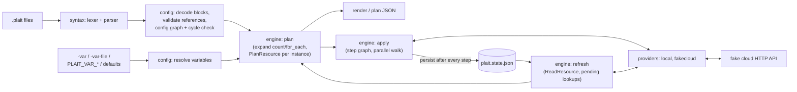

# plait architecture

This document describes how plait turns `.plait` files into converged
infrastructure: the pipeline, the data model, the two graphs, the apply
protocol that makes crashes recoverable, and the complexity of each stage.

## Pipeline



| Package | Responsibility |
|---|---|
| `internal/value` | Dynamic values (null, bool, number, string, list, map, **unknown**), deep equality, HCL-style rendering, JSON codec with an unknown marker, type constraints and safe conversions. |
| `internal/syntax` | Hand-written lexer and recursive-descent parser for the HCL subset; AST; static reference extraction (`References`) that ignores names bound by `for` expressions. |
| `internal/eval` | Expression evaluator with unknown propagation and a 39-function standard library. |
| `internal/addr` | Resource (`type.name`) and instance (`type.name[0]`, `type.name["k"]`) addresses, parsing and ordering. |
| `internal/config` | Decodes files into variables, locals, resources (with `count`, `for_each`, `depends_on`, `lifecycle`), outputs and providers; validates every reference; builds the configuration graph; resolves variables from all sources. |
| `internal/dag` | Graph with Tarjan cycle detection (readable cycle paths), deterministic topological sort, and a bounded-parallel walk that skips the dependents of failed nodes. |
| `internal/state` | State model (current/deposed objects with ready/pending/tainted status), JSON format, atomic store with backup, lock file with stale-lock detection. |
| `internal/provider` | The plugin interface, schema types, config validation and the standard planning rules (`PlanFromSchema`). |
| `internal/provider/localfs` | `local_file`, `local_directory`, confined to a root directory. |
| `internal/provider/cloudprov` | `fakecloud_network`, `fakecloud_instance`, `fakecloud_bucket` over HTTP with retries and idempotency keys. |
| `internal/fakecloud` | The in-memory cloud API server with referential integrity and fault injection. |
| `internal/engine` | Refresh, plan, apply, plan rendering and the saved-plan format. |
| `internal/workspace` | Wires config, variables, state store, lock and engine into locked sessions. |
| `internal/cli`, `cmd/plait` | The command-line interface. |

## Values and "known after apply"

`value.Value` is an immutable tagged union. `Unknown` is a first-class kind:
every operator, traversal, template and function returns `Unknown` when an
input it needs is unknown (functions may opt in to receiving collections that
merely *contain* unknowns, e.g. `length` and `concat`). Two consequences:

- A plan can carry partially known objects, e.g. a `local_file` whose content
  joins IPs that do not exist yet: `content = (known after apply)`.
- `Equal` treats unknown as unequal to everything, so an attribute that
  becomes unknown is always a change.

Unknown values may appear in plans (encoded as
`{"__plait_unknown__": true}`) but never in state; the state encoder rejects
them. While a create is in flight the planned object is stored with unknowns
replaced by null.

## The configuration graph

Nodes are `var.X`, `local.X`, `output.X`, `provider.X` and each resource
`type.name`. Edges come from static references in expressions (plus
`depends_on`, plus the provider block a resource's type implies). The graph is
checked once at load time with Tarjan's SCC algorithm; any cycle is reported
as a concrete path, e.g.

```
dependency cycle: local.a -> local.b -> local.a
```

`count.index`, `each.key/value` and `path.*` create no edges. References to
undeclared variables/locals/resources, `count.index` outside counted
resources, and similar mistakes are load-time errors with positions.

## Planning

`Engine.Plan(prior, opts)`:

1. **Clone and refresh.** For every tracked object, call `ReadResource`
   (bounded-parallel, via `dag.Walk` on an edgeless graph). Objects that no
   longer exist are dropped; changed ones are updated; **pending** objects are
   looked up by their create token and become `ready` ("recovered") or are
   dropped with their token remembered ("abandoned"). Differences are
   reported as drift.
2. **Walk the config graph in topological order.** Variables, locals and
   outputs are evaluated lazily; for each resource:
   - evaluate `count`/`for_each` (must be known) to get the instance keys;
   - for each instance evaluate its attributes with `count.index` or
     `each.key/value` in scope, validate them against the provider schema and
     apply `ignore_changes` (configured values replaced by prior values);
   - ask the provider to plan: `PlanResource(prior, config)`. The provider
     returns the planned object (unknown where it cannot know) and the
     attributes that force replacement;
   - classify: no prior → **create**; tainted prior → **replace**;
     `RequiresReplace` non-empty → **replace** (re-planned as a fresh create);
     planned equals prior → **no-op**; otherwise **update**. Replacements are
     delete-then-create unless `create_before_destroy` is set.
   - the instance's planned value (or prior value for no-ops) becomes what
     later references see; aggregate values are an object, a list (`count`)
     or a map (`for_each`).
3. **Orphans.** Tracked instances not produced by the configuration are
   deleted (with the reason); deposed objects are deleted.
4. **Outputs** are evaluated and diffed against the stored outputs.

The plan records, per resource, the expanded instance keys so apply can
rebuild aggregate values, plus the refreshed prior state, the variables and a
digest of the configuration.

### Standard provider planning rules

`provider.PlanFromSchema` implements the rules most resources need:

| Attribute kind | Create | Update |
|---|---|---|
| configured (Required/Optional) | configured value | configured value |
| Optional+Computed, unset | unknown | prior value |
| Computed only | unknown | prior value |
| ForceNew whose planned value differs from prior (incl. unknown) | — | requires replacement |

Providers refine this: the local provider computes `content_sha256` and
`size` at plan time when the content is known; the fake cloud provider fills
documented API defaults (`size = "small"`, `tags = {}`) so they are known.

## Apply

### Step graph

Each non-no-op change becomes one or two steps:

| Change | Steps |
|---|---|
| create / update | `A (create)` / `A (update)` |
| delete | `A (destroy)` |
| delete-then-create | `A (destroy)` → `A (create)` |
| create-then-delete | `A (create)` → `A (destroy replaced)` |
| deposed object | `A (destroy deposed)` |

Ordering edges, where A depends on resource D (from the configuration, or
from the dependencies recorded in state for orphans):

1. `A (create|update)` runs after `D (create|update)`.
2. Any destroy step of D runs after every destroy step of A — dependents are
   removed first (the fake cloud enforces this with a 409).
3. `A (destroy replaced)` runs after every dependent's create/update, so
   dependents are re-pointed at the new object before the old one goes.
4. A new create-before-destroy of A runs after an older deposed object of A
   has been destroyed (one deposed slot per instance).

Mixing rule 2 with rule 3 across a delete-then-create dependency and a
create-before-destroy dependent produces a cycle; plait reports it with a hint
rather than silently changing the plan. The golden tests print the step graph
of every case, e.g. for a forced replacement of a network with an attached
instance:

```
fakecloud_instance.web (create): fakecloud_instance.web (destroy)
fakecloud_instance.web (create): fakecloud_network.main (create)
fakecloud_network.main (create): fakecloud_network.main (destroy)
fakecloud_network.main (destroy): fakecloud_instance.web (destroy)
```

### Executing a step

The graph is walked by `dag.Walk` with `-parallelism` workers (default 4).
For a create:

1. Re-evaluate the instance's configuration against the **working state**
   (dependencies are now real objects), re-plan with the provider and check
   that every value known in the reviewed plan is unchanged.
2. **Write-ahead:** record the object as `pending` with its planned
   attributes and an idempotency token; persist state (atomic rename).
3. Call `ApplyResource` with the token.
4. On success record the object as `ready`; if the provider returned an
   object *and* an error, record it as `tainted` (it will be replaced); if it
   returned only an error, leave it `pending` — the outcome is unknown.
5. Persist state again.

Updates and deletes persist after the provider call; they need no
write-ahead record because the object's identity is already in state. A
failed step makes `dag.Walk` skip its transitive dependents (reported as
"skipped because X failed") while independent branches continue.

### Crash recovery

Because of the write-ahead record, a crash at any instant leaves one of
these states, all of which the next run repairs:

| Crash point | State left behind | Next run |
|---|---|---|
| before the pending record is written | nothing | plans the create again |
| after the record, before the request commits | `pending` + token, no object | lookup misses → "abandoned" → re-created **with the same token** |
| after the request commits, before the response | `pending` + token, object exists | lookup by token → "recovered", tracked, no duplicate |
| after the response, before the ready record | same as above | same as above |
| during a delete | object still in state, gone remotely | refresh drops it ("has been deleted") |
| during create_before_destroy | old object deposed, new one pending | pending resolved, deposed object destroyed |
| any of the above | lock file held by a dead PID | lock broken automatically (same host) |

Reusing the token for abandoned creates closes the last gap: if the crashed
process's request was still being processed when the lookup ran, the late
request and the re-create carry the same key, so the server returns one
object for both. `test/integration/crash_test.go` exercises the rows above by
running the real CLI as a child process and SIGKILLing it from inside the fake
cloud's commit hook, after the server committed but before it responded.

## State format

```json
{
  "version": 1,
  "lineage": "random 128-bit id fixed at creation",
  "serial": 12,
  "outputs": { "web_ips": ["10.20.0.5"] },
  "resources": [
    {
      "address": "fakecloud_instance.web[0]",
      "type": "fakecloud_instance", "name": "web", "index_key": 0,
      "provider": "fakecloud",
      "current": { "status": "ready", "attributes": { "id": "i-0001", "...": "..." } },
      "deposed": null,
      "dependencies": ["fakecloud_network.main"]
    }
  ]
}
```

Writes go to a temp file in the same directory, are fsynced, the previous
file is copied to `.backup`, and the temp file is renamed over the original
(then the directory is fsynced). Every write increments `serial`; saved plans
record `lineage` + `serial` and are refused if either moved.

## Locking

`plait.state.json.lock` is created with `O_CREATE|O_EXCL` and holds the
holder's ID, operation, user, PID, host and start time. Contenders retry
until `-lock-timeout`, then fail with the holder's details and the exact
`plait force-unlock <ID>` command. A lock whose PID no longer exists on the
same host is removed automatically and the takeover is logged.

## Provider protocol

```go
type Provider interface {
    Schema() Schema
    Configure(ctx, config value.Value) error
    PlanResource(ctx, PlanRequest{Type, Prior, Config}) (PlanResponse{Planned, RequiresReplace}, error)
    ApplyResource(ctx, ApplyRequest{Type, Prior, Planned, CreateToken}) (ApplyResponse{New}, error)
    ReadResource(ctx, ReadRequest{Type, Prior, Pending, CreateToken}) (ReadResponse{Current}, error)
}
```

Apply semantics are encoded in the request: null `Prior` is a create, null
`Planned` a delete, otherwise an update. Contract for implementers:

- `PlanResource` is pure and deterministic.
- A create carrying a `CreateToken` must be idempotent for that token, and
  `ReadResource{Pending: true}` must find the object by it (or by a natural
  key, as the local provider does with paths).
- Returning a non-null `New` together with an error means "the object exists
  but is not fully configured"; the engine taints it.
- `ReadResource` returns null when the object is gone.

The fake cloud provider retries 429/5xx with exponential backoff; retrying a
create is safe because the idempotency key makes the server return the
original object.

## Complexity

V = configuration nodes, E = reference edges, I = resource instances,
C = planned changes, P = dependency pairs between changed instances.

| Stage | Time | Notes |
|---|---|---|
| Lex + parse | O(source length) | single pass, recursive descent |
| Reference validation + config graph | O(V + E) | |
| Cycle detection | O(V + E) | Tarjan SCC; one BFS per cyclic component for the reported path |
| Topological sort | O((V + E) log V) | heap for deterministic tie-breaking |
| Plan | O(V + E + I·(attrs + deps)) | each instance evaluated once; `ResourceDeps` is a DFS per resource |
| Apply graph | O(C + P) | changes indexed by resource and by dependency |
| Apply walk | O(C + P) scheduling + provider time | at most `parallelism` provider calls in flight |
| State write | O(state size) per step | atomic rewrite of the whole file after every step |

The per-step full state rewrite is the dominant non-provider cost for large
applies (it is what makes every step durable). `make bench` measures plan and
apply on synthetic configurations of chained resources with an in-memory
provider and no persistence; see the README for the numbers.
